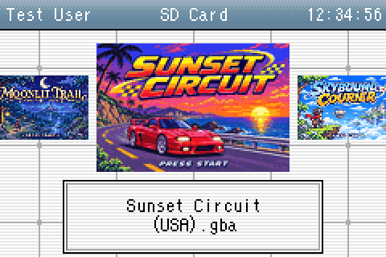
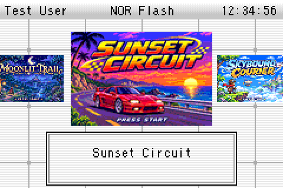
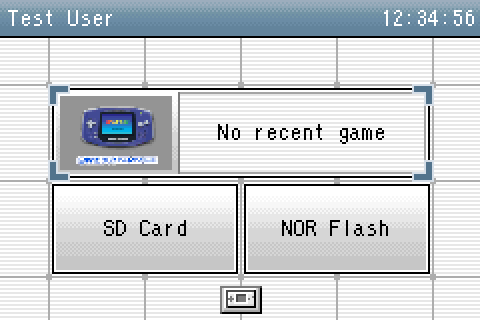
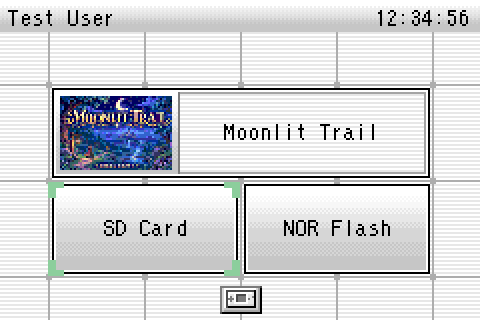

# DS Style Merkin's Mix (DSSMM)

DSSMM brings a Nintendo DS-inspired game menu to EZ-FLASH OMEGA-family cards
and, through the developing SuperFW port, SuperCard-family cards. Browse games
by their artwork, return to favorites and recently played titles, and make the
menu your own.

Maintained by [Merkin](https://github.com/voluptuary), Merkin's Mix builds on
[FrankieT19’s DS Style forks](https://github.com/FrankieT19), EZ-FLASH’s kernels
and Sterophonick’s SimpleLight. The separate SuperCard port builds on
[David Guillen Fandos’s SuperFW](https://github.com/davidgfnet/superfw).

## What DSSMM offers

- **A visual game library:** list, artwork list, horizontal and vertical carousel
  views, with title screens or box covers and previews of neighboring games.
- **Artwork for more than GBA:** match images by filename for supported emulator
  systems, use existing GBA title packs, and give folders their own pictures.
  Compatible transparent artwork blends into the menu background.
- **Faster access to your games:** a Start screen, last-played shortcuts, recent
  games and configurable startup behavior. OMEGA-family builds also offer favorites.
- **A tidier library:** optional wrap-around navigation and Clean list names that
  hide tags such as `(USA)` and `(En)` without renaming your files.
- **Personal touches:** DS Style backgrounds, Light/Dark themes, accents and
  artwork choices. OMEGA-family builds also support clock-based Auto themes;
  SuperFW offers an optional DSSMM font and independent top-bar colors.
- **Convenient game and card controls:** built-in MiGoomba GB/GBC emulation,
  clearer NOR management where supported, and save/settings improvements.
  OMEGA-family builds include optional remembered cheat selections and collapsible groups.

Features and plugin compatibility depend on the card. SuperFW is still being
ported toward the EZ-FLASH version’s appearance and behavior.

## See it in action

| | EZ-FLASH DSSMM | SuperFW DSSMM |
| --- | --- | --- |
| Artwork carousels |  |  |
| Start and menus |  |  |

Development previews recorded from the actual menu renderers in mGBA, using
original sample artwork for fictional games. They show the interface, not a
measurement of physical-card performance; released builds may differ.

## Choose the kernel for your exact card

**The three OMEGA-family kernels are not interchangeable. Check your card before
installing an update.**

| Your cartridge | Kernel download | Update file | Status |
| --- | --- | --- | --- |
| EZ-FLASH OMEGA **Definitive Edition Rev. A or Rev. B** | [DSSMM 8.4.1](https://github.com/voluptuary/dssmm/releases/tag/v8.4.1) | `ezkernelnew.bin` | Stable release |
| **Original EZ-FLASH OMEGA** | [DSSMM 8.4.1 — OMEGA Test 5](https://github.com/voluptuary/dssmm/releases/tag/v8.4.1-omega-test5) | `ezkernel.bin` | Experimental; not hardware-verified |
| Newer EZ-FLASH OMEGA **Definitive Edition B / BLUE** | [DSSMM 8.4.1 — BLUE Test 5](https://github.com/voluptuary/dssmm/releases/tag/v8.4.1-blue-test5) | `ezbluekernel.bin` | Experimental; not hardware-verified |

**The older Definitive Edition Rev. B and the newer Definitive Edition B / BLUE
are different cards.** Use only the kernel and supporting SYSTEM files intended
for your model, and follow its release instructions.

> [!WARNING]
> **The Original OMEGA and BLUE ports have not been tested on physical hardware.**
> Installation, booting, games, saves, plugins, cheats/save states and NOR still
> need verification. BLUE’s sealed update image also needs updater verification.
> **Use these experimental builds with caution and at your own risk.**
> Back up the SD card and saves; avoid powering off during updates or writes.

## SuperCard and SuperChis

**[Download SuperFW Build 769](https://github.com/voluptuary/dssmm/releases/tag/superfw-build769)**
for **SuperChis/SuperChis Prime**, **SuperCard SD** or **SuperCard Lite**. Choose
the file for your exact card. The optional folder-art pack is included.

This developing port adds DS Style backgrounds, horizontal/vertical artwork
carousels, grouped settings, custom folder art and a Start screen with last-played
artwork and a 12/24-hour clock. Choose a DSSMM font, theme, accent and top-bar color.
Settings save when you leave their menu; artwork, settings, saves and plugins
live under `SYSTEM`.

Chis also supports an artwork carousel for its NOR library. When selecting a GBA
game, use the D-pad to choose loading or writing to NOR; replacing games requires
confirmation. Hardware-specific features stay with the cards that support them.
Prime has no hardware RTC or rumble, so themes switch manually.

**Only SuperChis Prime v1.0 has owner hardware testing; SD and Lite remain
untested.** Full EZ-FLASH menu parity and plugin compatibility are still in
progress. Read the release’s known issues, back up saves/current firmware and
follow [SuperFW’s installation and recovery guide](https://superfw.davidgf.net/docs/install/flash/).
These files are for SuperCard-family hardware, not OMEGA-family cards.

### Make and add artwork

1. Open [DS Style Card Companion (DSSCC)](https://github.com/voluptuary/dsscc/releases/latest),
   choose **Custom Pack → Scan SD Card…** (Custom Art in older versions), and
   select the SD-card root. Enable **Include Game Boy Advance files** if wanted,
   and choose both thumbnail sizes.
2. Check the images, select **Mirrored** output and choose **Build Pack**.
3. Copy the generated `IMGS` and `IMGS2` contents into `SYSTEM/IMGS` and
   `SYSTEM/IMGS2`, preserving subfolders.
4. On SuperFW, use **Start → Settings → Interface → Artwork** to choose Title
   or Box, then leave the submenu to save. Title is the default. **Start** opens
   the Start screen while browsing.
5. For folder pictures, extract the release’s `folder-art.zip` at the SD-card
   root and merge its `SYSTEM` folder. Keep your own same-named CUSTOM images
   if preferred.

SuperFW checks CUSTOM images first, then filename-matched artwork; Title mode
also supports GBA ROM-header artwork. Letter folders and custom folder pictures
are supported. See [artwork setup](superfw/docs/ARTWORK-SETUP.md) for examples
and troubleshooting; OMEGA-family owners can use their card’s guide below.

## GB/GBC games

The kernels include [MiGoomba](https://github.com/michyprima/migoomba) for Game Boy
and Game Boy Color. Back up `.esv` saves before updating; old emulator save states
are not guaranteed compatible. Prefer in-game battery saves when moving between
emulator versions.

## Guides

- [Definitive Edition Rev. A/B](ezfomegade/README.md)
- [Original OMEGA](ezfomega/README.md)
- [Definitive Edition B / BLUE](ezfblue/README.md)
- [SuperFW artwork and SD setup](superfw/docs/ARTWORK-SETUP.md) · [SuperFW manual](https://superfw.davidgf.net/)
- [DS Style Card Companion](https://github.com/voluptuary/dsscc) for finding and preparing artwork

## Credits

DSSMM builds on the work of the following contributors:

- **Merkin** — Merkin's Mix development and maintenance, artwork and
  transparency support, refreshed splash screens and system icons, rendering
  optimizations, kernel fixes and the platform ports, with AI assistance.
- **FrankieT19** — the DS Style foundations, animated carousels and launch
  presentation, separately authored v8.0 interface and navigation refinements,
  and the Original OMEGA DS Style adaptation used as that port's foundation.
- **The EZ-FLASH team**, including **fengflash** and **Windirt Young** — the
  original kernel sources and hardware foundations, including the BLUE source.
- **Sterophonick** — SimpleLight, part of the custom-kernel foundation.
- **exploitz86** — remembered per-game cheat selections, cheat-menu row and
  collapsed-group handling, and localized setting labels.
- **SkillerCMP** — the collapsible cheat-group foundation and cheat, save-state
  and patch-system contributions in the upstream lineage.
- **aidiadayo** — Thai language support.
- **Kekun** — the font-header capitalization correction used for compatibility
  with case-sensitive build systems.
- **ChaN** — FatFs, the filesystem library used by the kernels.
- **michyprima** — MiGoomba, the GB/GBC emulator in DSSMM 8.4.0, based on
  **Jaga / EvilJagaGenius**'s Jagoomba Color, **Dwedit**'s Goomba Color and
  **FluBBa**'s Goomba. Its upstream acknowledgments also credit **Minucce**,
  **Nuvie**, **Radimerry**, **Therealteamplayer** and **Endrift / mGBA**.
- **David Guillen Fandos (davidgfnet)** — author of SuperFW, maintained as a separate
  upstream project under `superfw/`; its source retains upstream licenses and credits.
- **Copilot, ChatGPT, and Claude** — contributions to interface integration, testing and
  release documentation. Other AI-assisted development work
  is recorded in the project history.

Thank you also to the upstream component authors, artwork/tool contributors,
and everyone who has tested builds and reported problems. The platform
[credit records](CREDITS.md) retain detailed attribution and provenance.

The repository includes the [Apache License 2.0](LICENSE). Individual components
retain their own licenses and attribution notices.
